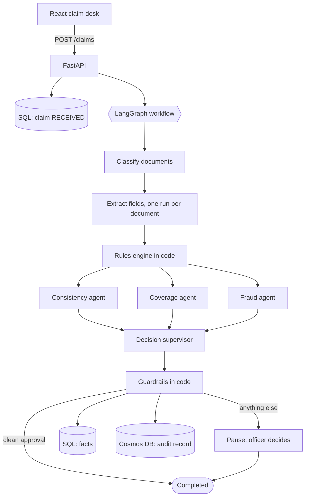

# Mediclaim Desk

**AI-assisted validation of health insurance reimbursement claims.** A claims officer uploads the documents of a claim. A LangGraph workflow reads them with GPT-5.1 agents, plain code checks the rules and calculates the money, guardrails stop the model from approving anything risky, and the officer confirms or sends the claim back.

> **Proof of concept. Synthetic data only.** This is a learning and portfolio project. It is not a clinical tool, it does not pay any claim, and it must not be used on real patient data.

<!--
## Screenshots
Add your own screenshots to docs/screenshots (see the README there), then uncomment these lines.


-->

## The idea in one sentence

**The AI model reads and judges. Plain code calculates and enforces. A person decides.**

- Reading messy documents, noticing that two patient names are probably different people, and mapping "inguinal hernia repair" to a policy waiting period are jobs for a language model.
- Adding up a bill, checking dates, finding a duplicate bill, and computing the payable amount are jobs for code, because code is exact and repeatable.
- Anything that is not a clean approval goes to a human officer.

## Flow

1. The officer opens the **React claim desk** and submits a claim: a policy number and its documents (or clicks a one-click demo claim).
2. **FastAPI** checks the files (type, size, count), stores them, creates a claim in **SQL** with status RECEIVED, and answers immediately with a claim id.
3. In the background one **LangGraph** run starts, with the claim id as its thread id. A classifier agent identifies each document: claim form, hospital bill, discharge summary, prescription, ID proof.
4. One extractor run per document, in parallel, pulls structured fields (names, dates, bill number, line items). The model must return JSON that matches a Pydantic schema.
5. The **rules engine (plain Python)** checks: required documents, bill total against line items, policy number, policy period, waiting period, late filing, sum insured, and **duplicate bills (SQL lookup)**. It also calculates the payable amount: non-payable items, room rent cap, co-payment.
6. Three agents run in parallel: **consistency** (same patient, coherent treatment), **coverage** (exclusions and waiting periods), **fraud** (anomalies, reused bills).
7. A **decision supervisor** agent recommends one of five outcomes: Approve, Partial approval, Query more information, Reject, Escalate to officer.
8. **Guardrails in code** overrule the model where needed: it cannot approve a claim with open findings; fraud signals always go to a person; low confidence goes to a person; amounts always come from the rules engine, never from the model.
9. Facts (decision, amounts, findings, reviews) are saved in **SQL**. The full audit record (extracted fields, every finding, the workflow trace, token usage) is saved in **Cosmos DB**.
10. If a person must decide, the workflow **pauses** (a LangGraph interrupt). The officer reviews the findings and the trace, then **confirms or sends the claim back**. The decision is stored with the reviewer's name, and the workflow resumes and finishes.



More detail (sequence diagram, guardrail table, API, data stores) is in [docs/ARCHITECTURE.md](docs/ARCHITECTURE.md).

## Tech stack

| Layer | Technology |
|---|---|
| UI | React 18, Vite |
| API | FastAPI, Pydantic |
| Workflow | LangGraph (parallel steps, fan-out and fan-in, human-in-the-loop pause) |
| Model | Azure OpenAI GPT-5.1 through the OpenAI Python SDK (v1 endpoint), strict JSON validation with retry |
| Facts store | Azure SQL (SQLite locally) through SQLAlchemy |
| Audit store | Cosmos DB (local JSON files by default) |
| Documents | Azure Blob Storage (local folder by default) |
| Tests | pytest, Vitest and Testing Library |

## Quick start (no Azure account needed)

You need Python 3.11 or newer and Node 20 or newer. Commands are for Windows PowerShell. On macOS or Linux use `source .venv/bin/activate` and `export NAME=value`.

**1. Start the API** in the first terminal:

```powershell
git clone https://github.com/<your-username>/mediclaim-desk.git
cd mediclaim-desk
python -m venv .venv
.\.venv\Scripts\Activate.ps1
pip install -r requirements.txt
python -m pytest -q
$env:LLM_PROVIDER = 'mock'
uvicorn claims_poc.api:create_app --factory --reload
```

**2. Start the UI** in a second terminal:

```powershell
cd frontend
npm install
npm run dev
```

Open http://localhost:5173. The API's own test page is at http://127.0.0.1:8000/docs.

`LLM_PROVIDER=mock` swaps the model for simple offline stand-ins that parse the sample documents. They let you run and demo the whole system for free. They are **not** a model and say nothing about AI quality.

## Demo script (about 5 minutes)

1. **Header badges.** Point out the workflow (LangGraph), the model (offline mock, or your Azure deployment), and the SQL and audit stores.
2. **Clean claim.** Click *Clean claim (appendicitis)*. Watch the claim move to *Awaiting review*. Show the **workflow trace**: AI steps, the code step, and the pause for a person. The recommendation is a partial approval: 93,000 claimed, 81,450 payable. Open *How the payable amount was calculated*: consumables are not payable, then 10% co-pay. Say: amounts come from code, never from the model.
3. **Confirm.** As the officer, confirm the decision. The claim becomes *Completed* and appears in the review history.
4. **Suspicious claim.** Click *Suspicious claim (hernia)*. The recommendation is *Escalate to officer*. Walk through the red findings: duplicate bill, bill total mismatch, different patient name, hernia waiting period, missing ID proof, late filing. Say: the model alone might have asked for more documents, but a **guardrail** forces a person to look at fraud signals.
5. **Send back.** Use *Send back to claimant* and add a comment.
6. **Duplicate detection.** Submit the clean claim again. It is now flagged as a **duplicate bill**, found through the SQL record of the first claim.
7. **Audit record.** Open *Full audit record*: extracted fields, findings, trace, and token usage per call.

Talking points: why the model never decides money; why fraud signals are not sent back to the claimant; how the evaluation harness measures false approvals.

## Use a real model (Azure OpenAI)

Create an Azure OpenAI or Microsoft Foundry resource and deploy a GPT-5.1 chat model. Your code needs the **deployment name**, not the model name.

```powershell
$env:LLM_PROVIDER = 'azure'
$env:AZURE_OPENAI_ENDPOINT = 'https://<your-resource>.openai.azure.com'
$env:AZURE_OPENAI_DEPLOYMENT = '<your deployment name>'
$env:AZURE_OPENAI_API_KEY = '<key>'      # or leave it unset and use Entra ID (az login)
uvicorn claims_poc.api:create_app --factory --reload
```

Optional storage in Azure (install `pyodbc azure-cosmos azure-storage-blob azure-identity` first): set `AZURE_SQL_CONN_STR`, `COSMOS_ENDPOINT` and `COSMOS_KEY`, `AZURE_STORAGE_CONN_STR`. All settings are listed in [.env.example](.env.example). Set `ENGINE=plain` to use the simple orchestrator instead of LangGraph.

## Configuration

| Setting | Purpose | Default |
|---|---|---|
| `LLM_PROVIDER` | `mock`, `azure` or `openai` | `openai` |
| `AZURE_OPENAI_ENDPOINT`, `AZURE_OPENAI_DEPLOYMENT`, `AZURE_OPENAI_API_KEY` | Azure OpenAI connection | none |
| `LLM_REASONING_EFFORT` | `none`, `low`, `medium`, `high` | model default |
| `ENGINE` | `graph` (LangGraph) or `plain` | `graph` |
| `SQL_URL` or `AZURE_SQL_CONN_STR` | Facts database | local SQLite file |
| `COSMOS_ENDPOINT`, `COSMOS_KEY` | Audit store | local JSON files |
| `AZURE_STORAGE_CONN_STR` | Document storage | `./local_blobs` |
| `API_KEY` | Optional shared key (UI sends `VITE_API_KEY`) | off |
| `CORS_ORIGINS` | Allowed UI origins | `http://localhost:5173` |
| `SEED_DEMO_DATA` | Load the sample policy and past bills | `true` |

## Project structure

```text
claims_poc/        API, workflow, agents, rules, storage
  api.py           FastAPI endpoints
  graph.py         LangGraph workflow (state, parallel steps, pause for a person)
  agents.py        the six agents and their prompts
  rules.py         deterministic checks and the payable calculation
  orchestrator.py  simple non-graph pipeline, the shared guardrails, the CLI path
  service.py       runs a claim, writes the trace, resumes after review
  db.py, stores.py SQL, Cosmos DB, Blob (each with a local fallback)
  llm.py           model wrapper: mock, OpenAI, Azure OpenAI
  chunking.py, retrieval.py, context.py, rag_coverage.py
                   policy retrieval modules (not wired into the pipeline yet)
  evaluate.py      evaluation harness with labelled cases
data/              fake policy, past bills, and two sample claims
frontend/          React claim desk
tests/             backend tests
docs/              architecture notes and screenshot instructions
```

## Tests

```powershell
python -m pytest -q                      # backend: 25 tests, offline
cd frontend; npm test; npm run build     # UI: 4 component tests and a production build
```

Measure the system with labelled cases:

```powershell
python -m claims_poc.evaluate --make-cases
python -m claims_poc.evaluate --mock                 # tests the harness itself
python -m claims_poc.evaluate --provider azure       # real model: decision accuracy, false approvals, cost
```

The number that matters most is **false approvals**: a bad claim that was approved. The target is zero.

## Status and limits

**Verified:** the backend (25 tests, including both workflow engines, duplicate detection through SQL, the human review flow, CORS), the evaluation harness, and the UI components (4 tests, production build). The API was also exercised over real HTTP with the offline mock.

**Not yet verified:** the live Azure parts have not been run against real Azure resources: Azure OpenAI GPT-5.1, Azure SQL, Cosmos DB and Blob Storage. The UI has been tested with component tests, not in a browser by the author of this repo. Expect small fixes on first contact.

**Known limits:**

- Text and text-layer PDFs only. Scanned documents need OCR (for example Azure AI Document Intelligence) and are reported as unreadable.
- The demo keeps the paused workflow in memory. After an API restart, an officer's decision is still saved in SQL, but the paused run cannot resume. Use a persistent LangGraph checkpointer in production.
- Processing runs in a background task, not a durable queue.
- The payable calculation is simplified (no proportionate deduction, sub-limits or day-care rules). The policy is a small JSON record.
- The policy retrieval modules (chunking, retrieval, context, RAG coverage) are built and tested but not wired into the pipeline yet.
- Authentication is a single optional API key.
- Real claims contain health data. Do not use any.

## Roadmap

- OCR for scanned bills (Azure AI Document Intelligence).
- Wire policy retrieval into the coverage agent, with citations to policy clauses.
- Persistent LangGraph checkpointer and a queue with a worker.
- Microsoft Entra ID sign-in for officers.
- Evaluation set of 50 or more labelled claims, including prompt-injection cases.

## License

MIT. See [LICENSE](LICENSE).
