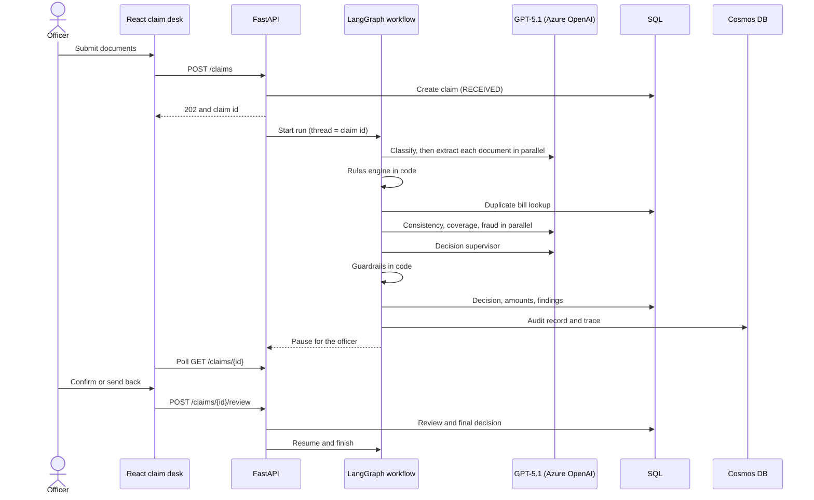

# Architecture

## Sequence

## Who does what

| Step | Done by | Why |
|---|---|---|
| Classify documents, extract fields | AI model | Reading messy text |
| Consistency, coverage, fraud analysis | AI model | Judgement over text |
| Totals, dates, policy period, waiting period, duplicates, payable amount | Plain code | Exact and repeatable |
| Final approval of anything risky | A person | Money and fairness |
| Overruling the model | Guardrails in code | The model can be wrong or tricked |

## Guardrails

| Rule | Effect |
|---|---|
| Open BLOCKER or WARN findings and the model suggests approval | Changed to Escalate to officer |
| Duplicate bill, bill total mismatch, or patient name mismatch | Always Escalate to officer, never sent back to the claimant |
| Model confidence below 0.7 | Escalate to officer |
| Approved amount | Always set from the rules engine; zero unless approved |
| Only a clean Approve skips human review | Everything else waits for an officer |

## Outcomes

| Outcome | Meaning |
|---|---|
| Approve | Complete documents, no findings |
| Partial approval | Valid claim, payable amount is lower only because of policy deductions |
| Query more information | Documents missing or unclear; the claimant can fix it |
| Reject | A clear exclusion, waiting period or policy mismatch |
| Escalate to officer | Fraud signals, conflicting evidence, or low confidence |

## Claim status

`RECEIVED` then `PROCESSING` then either `AWAITING_REVIEW` (a person must decide) or `COMPLETED`. `FAILED` shows the error.

## API

| Method and path | Purpose |
|---|---|
| `GET /health` | Liveness check |
| `GET /meta` | Workflow engine, model and stores in use (shown in the UI header) |
| `POST /claims` | Upload `policy_number` and `files`; returns 202 and a claim id |
| `GET /claims` | Recent claims for the queue |
| `GET /claims/{id}` | Status, recommendation, amounts, findings, documents, reviews |
| `GET /claims/{id}/audit` | Full audit record including the workflow trace |
| `POST /claims/{id}/review` | Officer's decision: reviewer, final decision, comment |

## Data

| Store | Holds |
|---|---|
| SQL: `policies` | Policy rules as JSON |
| SQL: `claims` | Status, AI decision, amounts, final decision |
| SQL: `claim_documents` | Files per claim and detected type |
| SQL: `findings` | Every finding per claim |
| SQL: `bills` | Every bill number processed, used to catch repeats |
| SQL: `reviews` | Who decided, when, and why |
| Cosmos DB `audit` (partition key `/claim_id`) | One JSON audit record per claim |
| Blob Storage (or `./local_blobs`) | The uploaded documents |

## Known design trade-off

A finished claim is written to two stores one after the other (SQL, then the audit store, or the reverse in code order). There is no transaction across them. If one write fails, they can disagree. A production version should treat SQL as the source of truth and retry the audit write, for example with an outbox table.
